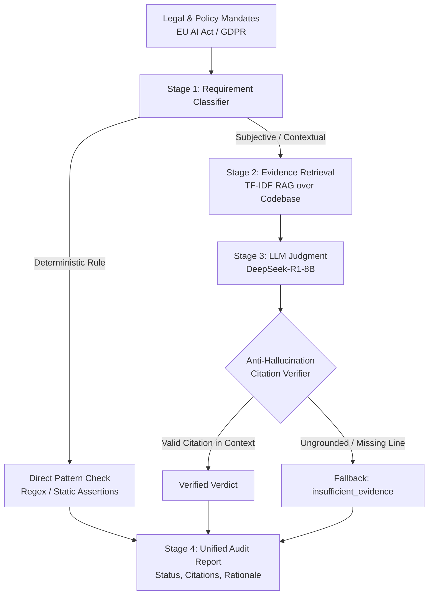

# Assignment 2: Exploratory Data Analysis, Pipeline Architecture & First Results

## 1. Exploratory Data Analysis (EDA) & Dataset Engineering

Modern compliance audits must evaluate both deterministic, low-level Infrastructure-as-Code (IaC) templates and unstructured, high-level statutory regulations. To build a reliable Compliance-as-Code AI auditor, we grounded our work in three real-world, public datasets without relying on synthetic or hand-crafted text.

### 1.1 Infrastructure-as-Code Compliance

Static Analysis rules from **Checkmarx KICS (v2.2.1)** provide deterministic ground-truth verification across Terraform (`.tf`) and Kubernetes (`.yaml`, `.json`) environments.

#### Key Dataset Characteristics & Split Strategy:

| Split | Compliant | Non-Compliant | Insufficient Evidence | Total Samples | Unique Rules |
| :--- | :--- | :--- | :--- | :--- | :--- |
| **Train** | 1,030 | 1,227 | 473 | **2,730** | 641 |
| **Validation** | 153 | 159 | 61 | **373** | 80 |
| **Test (In-Domain)** | 141 | 175 | 57 | **373** | 81 |
| **Test OOD (GCP Holdout)** | 131 | 144 | 81 | **356** | 81 |
| **Total** | **1,455** | **1,705** | **672** | **3,832** | **883** |

#### Key Observations during Data Engineering:
- **Preventing Shortcut Learning (Leak Sanitization)**:
  - *Problem*: In raw benchmark datasets, roughly **46% of test files** contained explicit indicator tokens in their filenames or comments (e.g., `positive_test.tf`, `# insecure configuration`).
  - *Remediation*: We implemented an automated regex sanitizer to strip all comments and rename identifiers to neutral tokens (`res1`, `obj1`). Label leakage dropped from 46% to **0.0%**, ensuring the model evaluates actual semantic properties rather than superficial cues.
- **Synthesizing Negative Controls (`insufficient_evidence`)**:
  - In real-world audits, the auditor frequently inspects files completely unrelated to a specific rule. We generated **672 negative-control examples** by pairing rules with mismatched resource blocks, teaching the model to state *"insufficient evidence"* rather than guessing.
- **Strict Rule Splitting & Out-of-Distribution (OOD) Holdout**:
  - To ensure the model does not memorize rules, splits were performed strictly by `query_id` (zero rule overlap between train and test).
  - Furthermore, all Google Cloud Platform (`GCP`) rules were held out entirely as an out-of-distribution benchmark (`test_ood`), testing how well knowledge learned on AWS/Azure/Kubernetes generalizes to a new provider.

### 1.2 Legal Frameworks & Codebase Evidence

To evaluate unstructured, high-level regulations, we integrated two statutory datasets with a multi-language codebase corpus:

- **EU AI Act (`safelegalaidata/eu-ai-act-structured`)**:
  - 677 atomic obligations across 118 articles, each quoting the exact statutory paragraph (e.g., Article 13 transparency, Article 15 cybersecurity).
- **GDPR (`AYI-NEDJIMI/gdpr-en`)**:
  - 152 atomic obligations across 57 articles covering data minimization, encryption, and subject rights.
- **Codebase Evidence Corpus (`aioutfitters/llm-sast-v1`)**:
  - A diverse pool of **19,024 source files** from **3,055 public repositories** across 18 languages and configurations (Terraform, Dockerfile, Helm, Kubernetes, Python, Go, etc.). We sampled 500 diverse files across 292 repositories for live retrieval.

## 2. Auditing Pipeline Architecture

We designed a dual-track architecture: a **Fine-Tuned Small Language Model (SLM)** for fast, deterministic code audits, and a **4-Stage Agentic RAG Pipeline** for complex regulatory oversight.

---

### Step-by-Step Pipeline Flow

1. **Stage 1 — Requirement Classification**:
   - Regulatory clauses are parsed in batches.
   - The engine separates deterministic checks (e.g., encryption ciphers, default open ports) from contextual requirements needing human-like reasoning (e.g., risk management, human oversight).
2. **Stage 2 — Context-Aware Evidence Retrieval (RAG)**:
   - For subjective requirements, a TF-IDF vector search indexes the codebase corpus and retrieves the top-3 most relevant configuration files or source snippets.
3. **Stage 3 — Verdict with Anti-Hallucination Guardrail**:
   - The LLM receives the requirement and **only its own retrieved snippet**.
   - **Guardrail Mechanism**: The engine extracts the citations (line numbers and exact code) returned by the model and cross-references them against the actual retrieved file. If a citation references a phantom line, the verdict is automatically downgraded to `insufficient_evidence`.
4. **Stage 4 — Audit Report Generation**:
   - Outputs a structured compliance summary containing:
     - **Status**: `compliant`, `non_compliant`, or `insufficient_evidence`
     - **Citations**: File, line number, and offending code snippet
     - **Rationale**: Auditor reasoning linking the code line to the legal article

## 3. First Results & Experimental Observations

Our experiments yielded encouraging results across both fine-tuned model training on Kaggle (T4 GPU) and zero-shot reasoning pipelines.

### 3.1 Model Training & Convergence (Qwen3-4B LoRA SFT)

- **Setup**: `Qwen3-4B` fine-tuned in 4-bit precision using LoRA ($r=16, \alpha=32$) on a single Nvidia T4 GPU for 3 epochs.
- **Observations**:
  - **Rapid Loss Reduction**: Training loss dropped steadily from $0.0360$ (Epoch 1) to $0.0223$ (Epoch 3), with validation perplexity stabilizing at $1.033$.
  - **Near-Perfect JSON Compliance**: The model achieved **99.7% JSON format adherence** on the test set, proving that small models can reliably output strict schemas without extra parsing layers.
  - **Fast Execution**: Average inference latency was **2.16 seconds per sample**, suitable for CI/CD continuous integration gates.

### 3.2 Evaluation Highlights: In-Domain vs. Out-of-Distribution (OOD)

| Metric Area | In-Domain Test (`test`) | OOD Holdout (`test_ood` - GCP) | Key Takeaway |
| :--- | :--- | :--- | :--- |
| **Overall Accuracy** | **77.2%** | **79.8%** | High baseline compliance detection across all splits |
| **Macro F1 Score** | **0.8018** | **0.8168** | Stable performance without provider overfitting |
| **Violation Recall** | **80.6%** | **87.5%** | Catches the vast majority of real non-compliant lines |
| **Negative Control F1** | **0.9189** | **0.9620** | Effectively ignores irrelevant configuration files |
| **Citation Line F1** | **75.7%** | **48.1%** | Strong line precision in-domain; syntax gap in OOD |
| **Hallucinated Citations** | **1.4%** | **4.9%** | Very few ungrounded line citations |

---

### 3.3 What the Results Mean (Key Observations for Discussion)

1. **Zero-Leakage Generalization**:
   - The model achieved an **0.8168 Macro F1** on the unseen GCP holdout split. This confirms that the model is learning general infrastructure security semantics (e.g., open CIDR ranges, missing encryption keys) rather than memorizing AWS/Azure-specific syntax.
2. **High Robustness Against False Alarms**:
   - With an F1 score above **91% on `insufficient_evidence`**, the model avoids hallucinating compliance violations when presented with unrelated infrastructure templates.
3. **The "Citation Precision" Gap on OOD Data**:
   - While the model correctly identified non-compliant GCP resources (87.5% recall), the exact line-level citation accuracy dropped from **75.7%** (in-domain) to **48.1%** (OOD). This shows that while high-level policy violation detection transfers well across cloud providers, exact line localization is sensitive to provider-specific syntax.
4. **Performance by Compliance Category**:
   - Categories with direct attribute definitions (**Best Practices: 92.6%**, **Insecure Configurations: 86.7%**, **Observability & Logging: 81.2%**, **Access Control: 81.1%**) performed exceptionally well.
   - Categories involving multi-block network topologies (**Networking & Security Groups: 53.8%**) proved more challenging, highlighting the need for multi-file graph context.
5. **Agentic Guardrail Effectiveness**:
   - In the natural-language regulatory pipeline, whenever DeepSeek-R1 encountered ambiguous context or produced ungrounded line references, the verification guardrail intercepted the output and marked it as `insufficient_evidence`, preventing false approvals.